# JungleAttack

## jungleattack.servidor.aplicacion

### AplicacionServidor

- Métodos: main(String[] args)

Punto de entrada del servidor. Crea el GestorPartidas y el ServidorSockets, registra el cierre ordenado del puerto para cuando termine el programa y arranca el servidor.

### ConfiguracionServidor

- Atributos estáticos: PUERTO: int, MAX_PARTIDAS: int

Contiene la configuración general del servidor: el puerto donde escucha (5001) y la cantidad máxima de partidas activas (100).

## jungleattack.servidor.red

### ServidorSockets

- Atributos: puerto: int, gestorPartidas: GestorPartidas, hilos: ExecutorService, activo: boolean, servidor: ServerSocket
- Métodos: inicio(), cierre()

Acepta conexiones de clientes y crea un manejador para cada conexión, que se ejecuta en su propio hilo. Si algo falla con un cliente, solo se cierra el socket de ese cliente y el servidor sigue aceptando a los demás.

### ManejadorCliente

- Atributos: socket: Socket, contexto: ContextoCliente, emisor: EmisorMensajes, receptor: ReceptorMensajes, procesador: ProcesadorMensajes, semaforo: Semaphore, cerrado: AtomicBoolean
- Métodos: recepcionMensajes(), consultaContexto(), envioMensaje(mensaje), ejecucionProtegida(comando, mensaje), cierre()

Representa una conexión individual con un cliente. Cada instancia tiene su propio semáforo para coordinar la ejecución de comandos que llegan por esa conexión.

El semáforo protege las operaciones que deben ejecutarse de manera secuencial para un cliente. Siempre se libera, aunque el comando falle. Si un comando lanza una excepción, la conexión no se corta: se registra el fallo y se le envía al cliente un ERROR con el motivo ERROR_INTERNO. La sincronización del estado compartido de una partida también debe controlarse cuando participan varios clientes.

Al cerrar la conexión (una sola vez, gracias a cerrado), se procesa un mensaje interno DISCONNECT para limpiar al jugador y se cierra el socket.

### EmisorMensajes

- Atributos: salida: PrintWriter
- Métodos: envioMensaje(mensaje: Mensaje)

Envía mensajes al cliente correspondiente, un objeto JSON por línea. El método es sincronizado para que no se mezclen los mensajes cuando varios hilos envían al mismo cliente.

### ReceptorMensajes

- Atributos: entrada: BufferedReader, destino: Consumer<Mensaje>, activo: boolean
- Métodos: recepcionMensajes(), cierre()

Lee los mensajes recibidos (una línea por mensaje) y entrega cada mensaje individual al destino para su procesamiento, sin almacenar temporalmente el contenido de diferentes solicitudes en un atributo compartido. Las líneas vacías se ignoran. Si una línea no es un JSON válido, entrega un mensaje de tipo INVALID para que se responda con un error.

## jungleattack.servidor.protocolo

### Mensaje

- Atributos: tipo: String, contenido: String
- Métodos: consultaTipo(), consultaContenido()

Representa un mensaje individual del protocolo de comunicación. El contenido son los datos escritos como texto JSON. Es inmutable.

### ConversorMensajes

- Atributos estáticos: GSON: Gson
- Métodos estáticos:
    - conversionDesdeJson(json: String)
    - conversionAJson(mensaje: Mensaje)
    - creacionMensaje(tipo, camposYValores...)
    - creacionMensajeConContenido(tipo, contenido: JsonObject)
    - contenidoComoObjeto(mensaje)
    - campoDelContenido(mensaje, campo)

Convierte los mensajes entre JSON y los objetos utilizados por el servidor. Usa Gson, así que el JSON nunca se arma concatenando textos. En el JSON cada mensaje tiene los campos tipo y contenido, y el contenido es a su vez un texto JSON con los datos del mensaje. Los nombres de los tipos (por ejemplo, CREATE_MATCH) y de los campos del contenido están en common.constantes.ConstantesProtocolo.

### ProcesadorMensajes

- Atributos: comandos: Map<String, ComandoCliente>, contexto: ContextoCliente
- Métodos: procesamientoMensaje(mensaje: Mensaje)

Identifica el tipo de mensaje, obtiene el comando correspondiente y solicita su ejecución a través de ManejadorCliente.ejecucionProtegida. Cada mensaje se procesa como una solicitud independiente. Si el tipo no existe o el mensaje no era un JSON válido, responde con un ERROR (TIPO_DESCONOCIDO o MENSAJE_INVALIDO).

## jungleattack.servidor.comandos

### ComandoCliente — interfaz

- Métodos: ejecucion(mensaje: Mensaje, contexto: ContextoCliente)

Define la operación común de los comandos solicitados por los clientes.

### ContextoCliente

- Atributos: jugador: Jugador, sesion: SesionPartida, conexion: ManejadorCliente
- Métodos: actualizacionContexto(jugador, sesion), envioMensaje(mensaje), consultaJugador(), consultaSesion(), consultaConexion()

Mantiene la información de la conexión y del jugador asociado. Permite que los comandos accedan a la sesión correspondiente y envíen respuestas al cliente. El jugador y la sesión son volátiles porque los leen varios hilos.

### ComandoCrearPartida

- Atributos: gestorPartidas: GestorPartidas
- Métodos: ejecucion(mensaje, contexto)

Valida el apodo y solicita la creación de una partida. El jugador que la crea queda registrado como su primer jugador y recibe MATCH_CREATED con el código de la partida. Responde con error si el cliente ya está en una partida o si el servidor llegó al máximo de partidas.

### ComandoUnirsePartida

- Atributos: gestorPartidas: GestorPartidas
- Métodos: ejecucion(mensaje, contexto)

Solicita la incorporación a una partida existente a partir de su código. Responde con error si el apodo es inválido, el código no existe o la partida ya está llena. Si el jugador entra, recibe MATCH_JOINED y los dos jugadores reciben ANIMAL_SELECTION para empezar la selección de especie.

### ComandoSeleccionarEspecie

- Métodos: ejecucion(mensaje, contexto)

Valida y registra la selección de especie del jugador. Responde con error si la especie no existe, si el jugador ya eligió o si el otro jugador ya la tiene. Después avisa a los dos jugadores cómo quedó la selección y, cuando ambos eligieron, inicia la partida.

### ComandoMoverAnimales

- Métodos: ejecucion(mensaje, contexto)

Recibe los identificadores de los animales seleccionados y el destino solicitado. Comprueba que la partida esté en curso, que los animales pertenezcan al jugador y que el destino sea válido, y solicita al motor del juego validar y ejecutar el movimiento.

### ComandoAtacar

- Métodos: ejecucion(mensaje, contexto)

Recibe los animales seleccionados y el objetivo del ataque. Verifica que la solicitud corresponda a una acción permitida (objetivo vivo, que no sea de la manada del jugador y que se encuentre en una zona que el jugador ve) y la comunica al motor del juego. Si ningún animal elegido está dentro del alcance, responde con el error FUERA_DE_ALCANCE.

### ComandoDesconexion

- Atributos: gestorPartidas: GestorPartidas
- Métodos: ejecucion(mensaje, contexto)

Gestiona la desconexión del jugador y actualiza la información de su conexión y partida. Lo que ocurre depende del estado de la partida (ver la sección sobre desconexión).

## jungleattack.servidor.partidas

### GestorPartidas

- Atributos: partidas: Map<String, SesionPartida>, aleatorio: Random
- Métodos:
    - creacionPartida()
    - unionPartida(codigo)
    - eliminacionPartida(codigo)
    - partidaPorCodigo(codigo)
    - cantidadPartidasActivas()
    - cantidadJugadoresConectados()
    - estadoPartida(codigo)

Administra las partidas activas y permite consultar su estado general. Las partidas se guardan en un ConcurrentHashMap indexado por código, lo que permite localizarlas rápido y coordinar el acceso concurrente. El código se genera con 4 caracteres alfanuméricos en mayúsculas, único entre las partidas activas, y se compara sin distinguir mayúsculas de minúsculas ni espacios. El Random se recibe por el constructor para poder controlarlo en las pruebas. Cuando una partida termina, se elimina del mapa.

### SesionPartida

- Atributos: codigo: String, jugadores: List<Jugador>, estado: EstadoPartida, mapa: Mapa, manadas: List<Manada>, tazas: List<Taza>, banderas: List<Bandera>, resumen: ResumenPartida, motorJuego: MotorJuego, reglasVictoria: ReglasVictoria, inicioPartida: long, reloj: LongSupplier, aleatorio: Random
- Métodos:
    - registroJugador(jugador)
    - eleccionEspecie(jugador, especie)
    - especiesDisponibles()
    - seleccionCompleta()
    - inicio()
    - finalizacion(ganador, razon)
    - cancelacion(motivo)
    - registroAlFinalizar(accion)
    - cantidadJugadoresConectados()
    - jugadorPorConexion(conexion)
    - animalPorIdentificador(identificador)
    - animalesEnZona(zona)
    - manadaPorJugador(jugador)
    - actualizacionEstado()
    - Métodos de consulta de sus atributos (consultaCodigo(), consultaEstado(), consultaJugadores(), consultaMapa(), consultaManadas(), consultaTazas(), consultaBanderas(), consultaMotor(), consultaResumen(), consultaReglasVictoria())

Representa una partida concreta y mantiene sus jugadores, mapa, objetos y motor de juego. Cada jugador tiene su propia bandera. Permite acceder a los animales y las manadas durante la partida.

Los métodos que cambian el estado de la sesión son sincronizados (por ejemplo, para que no entren tres jugadores o para que, si dos animales tocan una bandera casi al mismo tiempo, gane solo el primero). El generador aleatorio y el reloj se reciben por el constructor para poder controlarlos en las pruebas.

Al iniciar, crea el mapa, reparte las 7 manadas (2 de jugadores y 5 de bots) en 7 zonas distintas sorteadas, coloca una bandera por jugador en su zona inicial y coloca las tazas.

### Jugador

- Atributos: apodo: String, conexion: ManejadorCliente, especie: Especie, manada: ManadaJugador, conectado: boolean
- Métodos: apodoValido(apodo) (estático), seleccionEspecie(especie), asignacionManada(manada), consultaManada(), desconexion(), envioMensaje(mensaje), salidaDePartida(), consultaApodo(), consultaEspecie(), consultaConectado(), consultaConexion()

Representa a un participante y su manada de animales. Valida que el apodo no esté vacío ni supere el largo máximo.

### EstadoPartida — enum

- Valores: ESPERANDO_JUGADOR, SELECCION_ESPECIE, EN_CURSO, FINALIZADA

Representa los estados posibles de una partida.

### ResumenPartida

- Atributos: ganador: Jugador, razon: String, duracion: double, estadisticas: Map<Jugador, Estadisticas>
- Métodos: consultaGanador(), consultaRazon(), consultaDuracion(), consultaEstadisticas(jugador)

Conserva las estadísticas necesarias para presentar el resultado de la partida: el ganador, la razón del final (BANDERA o ABANDONO), la duración en segundos y las estadísticas de cada jugador.

### ResumenPartida.Estadisticas — clase interna

- Atributos: apodo: String, especie: Especie, botsEliminados: int, animalesPerdidos: int, tazasConsumidas: int
- Métodos: consultaApodo(), consultaEspecie(), consultaBotsEliminados(), consultaAnimalesPerdidos(), consultaTazasConsumidas()

Contiene los datos del resumen de un jugador: bots eliminados, animales de su manada que murieron y tazas consumidas.

## jungleattack.servidor.modelo

### Animal

Hereda de common.model.Animal.

- Atributos adicionales: manada: Manada, ruta: List<Punto>, indiceRuta: int, enMovimiento: boolean, posicionPrecisaX: double, posicionPrecisaY: double, ultimaActualizacion: long, objetivoAtaque: Animal, ultimoAtaque: long
- Métodos:
    - asignacionManada(manada)
    - consultaManada()
    - esBot()
    - asignacionRuta(ruta, ahora)
    - limpiezaRuta()
    - consultaRuta(), consultaIndiceRuta(), actualizacionIndiceRuta(indice)
    - consultaEnMovimiento()
    - consultaPosicionPrecisaX(), consultaPosicionPrecisaY(), actualizacionPosicionPrecisa(x, y)
    - consultaUltimaActualizacion(), actualizacionUltimaActualizacion(instante)
    - recepcionDanio(cantidad)
    - muerte()
    - intentoAtaque(ahora, enfriamiento)
    - ordenAtaque(objetivo)
    - detencionAtaque()
    - consultaObjetivoAtaque()

Representa un animal individual y mantiene su estado de movimiento y ataque. El identificador, la energía, el estado de vida, la posición y la especie se heredan de common.model.Animal. El servidor controla su energía, posición real, estado de vida y acciones permitidas.

La posición precisa (decimal) permite avanzar por la ruta a velocidad constante; la posición heredada (entera) es la que se comunica a los clientes. recepcionDanio devuelve true solo si ese golpe fue el que mató al animal, para que la eliminación se cuente una sola vez. intentoAtaque revisa y anota el instante del ataque en una sola operación, de modo que el enfriamiento de 1 segundo se cumple sin usar Thread.sleep por animal. Los métodos que cambian su estado son sincronizados, porque varios hilos pueden herir o mover al mismo animal.

### AnimalJugador — hereda de Animal

Representa a un animal controlado por un jugador. Puede recibir órdenes de movimiento y ataque a través del servidor. Nunca ataca automáticamente: solo lo hace cuando el jugador selecciona un objetivo.

### AnimalBot — hereda de Animal

- Métodos: esBot()

Representa a un animal controlado por el servidor. Se identifica como bot mediante esBot(); los ataques automáticos establecidos por las reglas del juego los ejecuta ReglasCombate.ataqueAutomatico.

### Manada — clase abstracta

- Atributos: especie: Especie, animales: List<Animal>, danio: AtomicInteger, energiaInicial: int
- Métodos:
    - creacionAnimal(identificador, posicion) (abstracto)
    - creacionAnimales(cantidad, centro)
    - posicionEnFormacion(centro, indice, total) (estático)
    - incorporacionAnimal(animal)
    - consultaAnimales()
    - animalesVivos()
    - animalPorIdentificador(identificador)
    - cantidadAnimalesVivos()
    - cantidadAnimalesMuertos()
    - consultaEspecie(), consultaDanio(), consultaEnergiaInicial()
    - incrementoDanio(cantidad)

Agrupa los animales de un jugador o de los bots. Mantiene la información compartida por la manada, como el daño que puede causar cada animal. Los animales se identifican con el nombre de la especie y un número (por ejemplo, jaguar-1) y se reparten en círculo alrededor del centro de su zona.

El ataque se ejecuta individualmente mediante los animales, no mediante la manada como un único atacante.

### ManadaJugador — hereda de Manada

- Atributos: tazasConsumidas: AtomicInteger, botsEliminados: AtomicInteger
- Métodos: consumoTaza(), consultaTazasConsumidas(), registroBotEliminado(), consultaBotsEliminados(), recuperacionEnergia(), animalesSeleccionados(identificadores)

Representa la manada de un jugador (10 animales con 20 de energía y daño 2) y permite localizar los animales que este selecciona para darles órdenes. consumoTaza() aumenta en 1 el daño de toda la manada y es acumulativo. recuperacionEnergia() suma 1 de energía a cada animal vivo sin superar MAX_PLAYER_ENERGY.

### ManadaBots — hereda de Manada

Agrupa los animales controlados por el servidor (4 animales con 10 de energía y daño 1 por cada especie que los jugadores no eligieron). Crea animales de tipo AnimalBot.

### Taza

- Atributos: identificador: String, posicion: Punto, consumida: AtomicBoolean
- Métodos: consultaIdentificador(), consultaPosicion(), consultaConsumida(), consumo()

Representa una taza que puede ser consumida por el primer animal que la toque. consumo() devuelve true solo para quien la consumió primero, aunque dos animales la toquen casi al mismo tiempo.

### Bandera

- Atributos: propietario: Jugador, zona: Zona, posicion: Punto
- Métodos: consultaPropietario(), consultaZona(), consultaPosicion(), deteccionContacto(animal)

Detecta el contacto de un animal con la bandera para solicitar la comprobación de la condición de victoria. Cada jugador tiene una bandera, y la victoria se logra al tocar la del oponente. Los bots y los animales del propietario no pueden tocarla.

### EventoCombate

- Atributos: tipo: Tipo, atacante: String, objetivo: String, especie: String, danio: int, x: int, y: int, zonaAtacante: int, zonaObjetivo: int
- Métodos: métodos de consulta de cada atributo

Representa un ataque o una muerte que ocurrió en la partida. Guarda la zona del atacante y del objetivo para que cada jugador reciba solo los eventos que ocurren en las zonas que ve. El cliente los usa para dibujar los efectos visuales.

### EventoCombate.Tipo — enum

- Valores: ATAQUE, MUERTE

## jungleattack.servidor.mapa

### Punto

Hereda de common.model.Punto.

Representa un punto del mapa utilizado por el servidor.

### Zona

Hereda de common.model.Zona.

- Atributos adicionales: nombre: String, poligono: List<Punto>, animalesPresentes: List<Animal>, tazasPresentes: List<Taza>
- Métodos:
    - consultaNombre()
    - consultaPoligono()
    - contienePunto(punto)
    - distanciaAlCentro(punto)
    - registroAnimal(animal)
    - eliminacionAnimal(animal)
    - registroTaza(taza)
    - eliminacionTaza(taza)
    - animalesEnZona()
    - tazasEnZona()

Representa una zona del mapa y permite localizar los animales y las tazas que se encuentran en ella. Las listas son CopyOnWriteArrayList porque el hilo de cada zona las actualiza mientras otros hilos las consultan.

Cuando un animal se desplaza entre zonas, el servidor debe actualizar su pertenencia a las zonas correspondientes para evitar mantener posiciones contradictorias.

### Camino

Hereda de common.model.Camino.

- Atributos adicionales: identificador: int
- Métodos: consultaIdentificador(), puntoEnFraccion(fraccion), zonaOpuesta(zona)

Representa una conexión transitable entre dos zonas. puntoEnFraccion devuelve el punto que está a esa fracción del camino (sirve para colocar las tazas sobre los caminos) y zonaOpuesta devuelve la zona del otro extremo.

### Mapa

- Atributos: zonas: List<Zona>, caminos: List<Camino>, ancho: int, alto: int
- Métodos:
    - generacionMapa()
    - generacionMapa(lector)
    - zonaPorIdentificador(identificador)
    - zonasConectadas(zona)
    - zonaPorPosicion(posicion)
    - actualizacionUbicacionAnimal(animal)
    - consultaZonas(), consultaCaminos(), consultaAncho(), consultaAlto()

Mantiene las zonas y los caminos del mapa y permite localizar los elementos durante la partida. Las 12 zonas y sus caminos se leen de mapa.json, que está en common. actualizacionUbicacionAnimal mueve al animal de la lista de una zona a la de otra cuando cruza el límite.

### BuscadorRutas

- Atributos: mapa: Mapa
- Métodos: busquedaRuta(origen, destino), busquedaRutaList(origen, destino)

Calcula una ruta válida por los caminos del mapa. busquedaRuta devuelve la lista de zonas entre dos zonas conectadas. busquedaRutaList devuelve la lista de puntos por los que debe caminar un animal desde su posición hasta el destino: ubica el punto más cercano sobre un camino para la salida y la llegada, y calcula el recorrido con el algoritmo de Dijkstra sobre el grafo de zonas, porque los caminos tienen longitudes distintas.

## jungleattack.servidor.reglas

### MotorJuego

- Atributos: sesion: SesionPartida, reglasMovimiento: ReglasMovimiento, reglasObjetos: ReglasObjetos, reglasCombate: ReglasCombate, registroEventos: RegistroEventos, actualizador: ActualizadorPartida, reloj: LongSupplier, hilosZona: List<HiloZona>, difusion: ScheduledExecutorService, ultimoEstadoEnviado: Map<Jugador, String>, ultimoEventoVisto: Map<Jugador, Long>, activo: boolean
- Métodos:
    - arranque()
    - cierre()
    - actualizacionJuego()
    - ejecucionOrdenMovimiento(jugador, animales, destino)
    - ejecucionOrdenAtaque(jugador, animales, objetivo)
    - comprobacionVictoria(animal)
    - actualizacionClientes()
    - consultaActivo(), consultaReglasCombate(), consultaRegistroEventos(), consultaReglasMovimiento()

Coordina las actualizaciones de la partida y las reglas del juego. Valida las órdenes recibidas, actualiza el estado real y comunica los cambios necesarios a los clientes.

Crea y administra los hilos de las zonas de la partida y un hilo adicional que, cada cierto tiempo, envía a cada jugador su STATE_UPDATE solo si lo que ve cambió desde el último envío (o si hay eventos de combate nuevos). Todos los hilos son daemon, así que no impiden que el servidor termine. actualizacionJuego() hace un ciclo completo sin hilos, lo que permite probar el motor de forma determinista con un reloj controlado.

### HiloZona — implementa Runnable

- Atributos: zona: Zona, mapa: Mapa, reglasMovimiento: ReglasMovimiento, reloj: LongSupplier, alMoverse: Consumer<Animal>, alActualizar: ObjLongConsumer<Animal>, activo: boolean
- Métodos: run(), actualizacionZona(ahora), cierre()

Actualiza los animales de una zona en cada ciclo, usando el tiempo transcurrido desde la actualización anterior. En cada ciclo mueve a los animales de su zona, actualiza su ubicación si cruzaron a otra zona, y revisa sus ataques y los objetos que tocaron. Se utiliza un hilo por zona y no un hilo por objeto, porque la cantidad de animales puede ser grande.

### ReglasMovimiento

- Atributos: mapa: Mapa, buscadorRutas: BuscadorRutas
- Métodos:
    - calculoRuta(origen, destino)
    - validarMovimiento(jugador, animales, destino)
    - inicioMovimiento(animal, destino, ahora, indice, total)
    - actualizacionPosicion(animal, ahora)
    - finalizacionMovimiento(animal)

Calcula las rutas y actualiza el movimiento de los animales. Las posiciones definitivas se determinan en el servidor. En cada ciclo el animal avanza ANIMAL_SPEED * tiempo transcurrido por su ruta, de modo que la velocidad se mantiene constante aunque un ciclo se retrase. Cuando se mueven varios animales a la vez, cada uno termina en un lugar distinto cerca del destino. Dar una orden de movimiento detiene el ataque en curso del animal.

### ReglasCombate

- Atributos: mapa: Mapa, manadas: List<Manada>, registroEventos: RegistroEventos, reglasObjetos: ReglasObjetos
- Métodos:
    - calculoDanio(animal)
    - aplicacionDanio(atacante, objetivo, ahora)
    - comprobacionAlcance(atacante, objetivo)
    - actualizacionAtaques(animal, ahora)
    - detencionAtaque(animal)
    - ataqueAutomatico(animalBot, ahora)

Gestiona los ataques individuales, el alcance, el daño y la detención de los ataques cuando el objetivo muere o deja de estar dentro del alcance. El alcance se calcula con el radio de encuentro definido en ConstantesComunes.

Los ataques de los animales controlados por jugadores se ejecutan de acuerdo con las órdenes recibidas: cada animal seleccionado ataca una vez por segundo mientras el objetivo siga vivo y al alcance. Los animales de los bots atacan automáticamente al animal de jugador vivo más cercano que esté dentro del alcance, y no se atacan entre sí. El enfriamiento de 1 segundo (ATTACK_COOLDOWN_MS) se controla con el instante del último ataque de cada animal. Cada ataque y cada muerte se registran como eventos de combate. Cuando un jugador elimina un bot, se cuenta la eliminación y se revisa la recuperación de energía.

### ReglasObjetos

- Métodos:
    - colocacionTazas(mapa, aleatorio)
    - consumoTaza(animal, taza)
    - recogidaTazas(animal, tazas, mapa)
    - recuperacionPorEliminaciones(manada, totalEliminados)

Gestiona la colocación y el consumo de tazas, así como la recuperación de energía por eliminaciones de bots. Las 10 tazas se colocan en posiciones aleatorias sobre los caminos, a una distancia mínima de las zonas que une cada camino. Solo los animales de jugadores consumen tazas, y la taza consumida desaparece de su zona. Cada 2 bots eliminados, todos los animales vivos de la manada ganan 1 de energía, sin superar el máximo de 20.

### ReglasVictoria

- Atributos: banderas: List<Bandera>, jugadores: List<Jugador>
- Métodos:
    - comprobacionVictoria(animal)
    - creacionResumen(ganador, razon, inicio, fin)

Comprueba las condiciones de victoria y genera el resumen de la partida cuando termina. La victoria la obtiene el jugador cuyo animal toca la bandera del oponente.

### RegistroEventos

- Atributos: eventos: List<EventoCombate>, primeraSecuencia: long
- Métodos: registro(evento), ultimaSecuencia(), desde(secuencia)

Guarda los eventos de combate recientes con un número de secuencia (hasta MAXIMO_EVENTOS_GUARDADOS). Así el motor entrega a cada jugador una sola vez los eventos nuevos que debe ver.

### ActualizadorPartida

- Atributos: sesion: SesionPartida
- Métodos:
    - zonasVisibles(jugador)
    - mensajeInicio(jugador)
    - mensajeEstado(jugador)
    - mensajeEstado(jugador, eventos)
    - mensajeFin(jugador)
    - envioInicio()

Coordina la preparación de las actualizaciones que se deben comunicar a los clientes (GAME_STARTED, STATE_UPDATE y GAME_OVER). La información enviada depende de la visibilidad que corresponda a cada jugador: solo se incluyen las zonas donde el jugador tiene al menos un animal vivo.

## jungleattack.servidor.constantes

### ConstantesJuego

- Atributos estáticos:
    - ENERGIA_ANIMAL_JUGADOR: int
    - ENERGIA_ANIMAL_BOTS: int
    - CANTIDAD_ANIMALES_JUGADOR: int
    - CANTIDAD_ANIMALES_BOTS: int
    - DANIO_JUGADOR: int
    - DANIO_BOTS: int
    - CANTIDAD_TAZAS: int
    - DANIO_POR_TAZA: int
    - ELIMINACIONES_POR_ENERGIA: int
    - ENERGIA_POR_ELIMINACIONES: int
    - ATTACK_COOLDOWN_MS: int
    - LONGITUD_CODIGO_PARTIDA: int
    - CARACTERES_CODIGO_PARTIDA: String
    - LONGITUD_MAXIMA_APODO: int
    - CANTIDAD_JUGADORES: int
    - RADIO_FORMACION: int
    - DISTANCIA_MINIMA_TAZA_ZONA: int
    - RADIO_BANDERA: int
    - RADIO_RECOGIDA_TAZA: int
    - MAXIMO_EVENTOS_GUARDADOS: int
    - INTERVALO_TICK_MS: int
    - INTERVALO_DIFUSION_MS: int
    - SEPARADOR_IDENTIFICADOR, PREFIJO_TAZA, PREFIJO_HILO_ZONA, NOMBRE_HILO_DIFUSION

Contiene las constantes utilizadas por las reglas de la partida. La energía, el daño y la cantidad de animales se definen por animal (cada animal de un jugador empieza con 20 de energía y cada bot con 10). El radio de encuentro (ENCOUNTER_RADIUS), la velocidad (ANIMAL_SPEED) y la energía máxima (MAX_PLAYER_ENERGY) se definen en ConstantesComunes, en common.

## common.model

Este paquete contiene los modelos comunes que comparten el cliente y el servidor.

### Animal

Contiene los atributos comunes de un animal, como identificador, energía, estado de vida, posición y especie.

### Zona

Contiene el identificador, la posición y las conexiones de una zona.

### Camino

Contiene las zonas de inicio y destino y la longitud del camino.

### Punto

Contiene las coordenadas del mapa.

### Especie

Contiene la identificación de la especie y los datos descriptivos que pueden compartir ambas aplicaciones, incluidos identificadores de recursos visuales y características generales del ataque.

El servidor conserva la lógica de las reglas, mientras que el cliente utiliza los recursos visuales y sonoros que correspondan.

## common.constantes

### ConstantesComunes

- Atributos estáticos: ANIMAL_SPEED: double, ENCOUNTER_RADIUS: double, MAX_PLAYER_ENERGY: int, además de los nombres de los campos de mapa.json

Contiene las constantes que deben tener el mismo valor en el cliente y en el servidor. El radio de encuentro y la velocidad los usa el servidor para calcular los combates y el movimiento, y el cliente para representar la animación.

### ConstantesProtocolo

Contiene los tipos de mensaje, los nombres de los campos del JSON y los motivos de error que usan el cliente y el servidor.

## Herencia, interfaces y polimorfismo

- common.model.Animal es la clase común de Animal.
- Animal es la clase base de AnimalJugador y AnimalBot. esBot() se redefine en AnimalBot.
- common.model.Zona es la clase común de Zona.
- common.model.Camino es la clase común de Camino.
- common.model.Punto es la clase común de Punto.
- Manada es la clase abstracta de ManadaJugador y ManadaBots. Cada una implementa creacionAnimal, así que Manada crea animales sin saber de qué tipo son.
- ComandoCliente es implementada por los comandos concretos.
- HiloZona implementa Runnable.
- ProcesadorMensajes ejecuta los comandos mediante la interfaz ComandoCliente.
- ReglasCombate puede trabajar con animales de jugador y bots mediante la clase base Animal, mientras que las decisiones específicas de los bots se identifican con AnimalBot.

## Elementos estáticos

- ConfiguracionServidor contiene la configuración del servidor.
- ConstantesJuego contiene las constantes de las reglas de la partida.
- ConstantesComunes y ConstantesProtocolo, en common, contienen las constantes compartidas con el cliente.
- ConversorMensajes contiene métodos estáticos para convertir mensajes.
- Jugador.apodoValido() y Manada.posicionEnFormacion() son métodos estáticos.

## Patrones de diseño

### Command

- Interfaz: ComandoCliente.
- Comandos concretos: ComandoCrearPartida, ComandoUnirsePartida, ComandoSeleccionarEspecie, ComandoMoverAnimales, ComandoAtacar y ComandoDesconexion.
- Invocador: ProcesadorMensajes.
- Cada comando encapsula una operación solicitada por un cliente.

## Comunicación y sincronización

Cada cliente tiene una instancia de ManejadorCliente y su propio semáforo. El procesamiento de las solicitudes de una conexión se coordina mediante ese semáforo cuando la operación requiere ejecución secuencial.

Cuando varios clientes modifican una misma partida, el servidor también debe proteger el estado compartido de la sesión. La sincronización por conexión no sustituye esa protección. Por eso los métodos de SesionPartida que cambian el estado y los de Animal que reciben daño, atacan o se mueven son sincronizados, y las listas compartidas son CopyOnWriteArrayList o clases atómicas.

Los mensajes se procesan individualmente. Los datos de una solicitud no deben guardarse en un atributo mutable compartido que pueda ser sobrescrito por otra solicitud.

La comunicación usa un objeto JSON por línea, siempre en UTF-8. El servidor es la autoridad: los dos clientes nunca hablan directamente entre sí, todos los mensajes pasan por el servidor.

## Actualización de la partida

El servidor mantiene el estado definitivo del juego y comunica a los clientes las actualizaciones necesarias.

La secuencia general es:

1. El cliente envía una orden de movimiento o de ataque.
2. ManejadorCliente recibe el mensaje.
3. ConversorMensajes convierte el JSON en un objeto Mensaje.
4. ProcesadorMensajes identifica el comando correspondiente.
5. El comando valida la solicitud y la comunica al MotorJuego.
6. El motor ejecuta las reglas y actualiza la sesión.
7. Los hilos de las zonas actualizan la ubicación de los animales y los objetos afectados.
8. ActualizadorPartida prepara las actualizaciones que corresponden a cada cliente.
9. Los clientes reciben los cambios y actualizan su representación visual.

El servidor determina las posiciones reales, las rutas válidas, los ataques, la energía, las muertes, el consumo de tazas y las condiciones de victoria.

La interfaz puede representar visualmente los movimientos entre las posiciones comunicadas, pero no decide el resultado definitivo de las acciones.

## Organización de los animales por zona

Cada animal pertenece a una manada y tiene una ubicación dentro del mapa. Las zonas mantienen referencias a los animales y objetos presentes para facilitar las consultas durante el juego.

Al cambiar de zona, el servidor actualiza la ubicación del animal y las listas de las zonas correspondientes. De esta forma, puede localizar los animales presentes, comprobar encuentros y consultar los elementos que pueden interactuar.

La organización permite conservar tanto la relación entre jugadores y manadas como la ubicación de los animales dentro del mapa.

Cada zona es actualizada por su propio HiloZona, que se ocupa únicamente de los animales y los objetos que están en ella.

## Visibilidad de las zonas

El servidor aplica la visibilidad: cada jugador solo recibe la información de las zonas donde tiene al menos un animal vivo. El cliente no recibe el mapa completo con su contenido y lo oculta, sino que solo recibe lo que puede ver. Las zonas que aparecen o desaparecen de su vista quedan reflejadas en el siguiente STATE_UPDATE, sin mensajes especiales.

Los eventos de ataque y muerte también se filtran: un jugador solo recibe los que ocurrieron en alguna de sus zonas visibles. Un jugador tampoco puede atacar a un animal que está en una zona que no ve.

El cambio de la zona que el jugador está mirando en pantalla lo hace el cliente con las zonas que ya recibió. Por eso el servidor no necesita un comando para consultar una zona (el tipo VIEW_ZONE existe en el protocolo, pero no se usa).

## Interpretación de las reglas del juego

- **P2P:** es una partida de jugador contra jugador. La arquitectura es cliente-servidor: los clientes nunca se comunican directamente.
- **Código de partida:** 4 caracteres alfanuméricos en mayúsculas generados por el servidor, únicos entre las partidas activas. La comparación no distingue mayúsculas de minúsculas.
- **Energía:** es por animal. Cada animal de un jugador empieza con 20 y cada bot con 10. Un animal muere cuando su energía llega a 0.
- **Capacidad de daño:** es una propiedad de la manada, compartida por todos sus animales. Cada ataque quita esa cantidad de energía al objetivo.
- **Encuentro:** dos animales se encuentran cuando la distancia entre ellos es menor o igual que ENCOUNTER_RADIUS.
- **Ataque de los bots:** cuando un animal de un jugador entra en el radio de un bot, cada bot de esa manada que esté dentro del alcance lo ataca automáticamente. Los bots no se atacan entre sí.
- **Ataque de los jugadores:** los animales de un jugador nunca atacan automáticamente. El jugador selecciona animales y hace clic sobre el objetivo. Cada animal seleccionado ataca una vez por segundo mientras el objetivo esté vivo y dentro del alcance.
- **Movimiento:** los animales solo se mueven por los caminos, a velocidad constante (ANIMAL_SPEED). La ruta se calcula con Dijkstra sobre el grafo del mapa.
- **Tazas:** hay 10 en total, en posiciones aleatorias sobre los caminos. La consume el primer animal de un jugador que la toca y desaparece. El +1 de daño se aplica a toda la manada y es acumulativo.
- **Bonificación de energía:** cada vez que el contador de bots eliminados de un jugador llega a un múltiplo de 2, cada animal vivo de su manada gana 1 de energía, sin superar MAX_PLAYER_ENERGY (20).
- **Bandera:** se toca cuando un animal del oponente queda dentro del radio de la bandera. La partida termina de inmediato.
- **Zonas iniciales:** las 7 manadas (2 jugadores y 5 bots) empiezan en 7 zonas distintas elegidas al azar entre las 12.
- **Jugadores:** una partida tiene 2 jugadores y no pueden elegir el mismo animal. Las 5 especies que no se eligen se convierten en bots.

## Desconexión de un jugador

Cuando un jugador se desconecta:

- Si no queda ningún jugador conectado en la partida, la partida se elimina.
- Si la partida está esperando jugador o en la selección de especie, la partida se cancela y el otro jugador recibe el error OPONENTE_DESCONECTADO.
- Si la partida está en curso, gana el jugador que se queda. La partida termina con la razón ABANDONO, se le envía el resumen y la partida se elimina.

Los sockets siempre se cierran al terminar la conexión, aunque ocurra un error.

## Pruebas unitarias

Las pruebas están en src/test/java, con la misma estructura de paquetes, y se ejecutan con mvn test (JUnit 5). Las que dependen del azar o del tiempo reciben un Random con semilla fija o un reloj controlado.

- jungleattack.servidor.mapa: MapaTest, BuscadorRutasTest
- jungleattack.servidor.modelo: AnimalCombateTest, ManadaTest, BanderaTest
- jungleattack.servidor.reglas: ReglasCombateTest, ReglasMovimientoTest, ReglasObjetosTest, ReglasVictoriaTest, RegistroEventosTest, HiloZonaTest, MotorJuegoTest, ActualizacionPartidaTest
- jungleattack.servidor.protocolo: ConversorMensajesTest
- jungleattack.servidor.partidas: GestorPartidasTest, JugadorTest, SesionPartidaTest, SesionPartidaInicioTest, SesionPartidaFinalTest
- jungleattack.servidor.red: ServidorIntegracionTest

Cubren, entre otras cosas, el combate (daño, muerte y enfriamiento de 1 segundo), la recuperación de energía cada 2 bots y su máximo, el consumo de tazas, la generación del código y la unión a una partida, la selección de especies, el movimiento a velocidad constante y el cálculo de rutas, la conversión de mensajes y la condición de victoria.

El flujo .github/workflows/tests.yml descarga este repositorio y el de JungleAttackCommon, instala common y ejecuta mvn clean verify en cada push y pull request (Java 21).

## Diagrama de clases

```mermaid
classDiagram
    class AplicacionServidor {
        +main(String[] args)
    }

    class ConfiguracionServidor {
        +PUERTO: int$
        +MAX_PARTIDAS: int$
    }

    class ServidorSockets {
        -puerto: int
        -gestorPartidas: GestorPartidas
        -hilos: ExecutorService
        -activo: boolean
        -servidor: ServerSocket
        +inicio()
        +cierre()
    }

    class ManejadorCliente {
        -socket: Socket
        -contexto: ContextoCliente
        -emisor: EmisorMensajes
        -receptor: ReceptorMensajes
        -procesador: ProcesadorMensajes
        -semaforo: Semaphore
        -cerrado: AtomicBoolean
        +recepcionMensajes()
        +consultaContexto()
        +envioMensaje(mensaje)
        +ejecucionProtegida(comando, mensaje)
        +cierre()
    }

    class EmisorMensajes {
        -salida: PrintWriter
        +envioMensaje(mensaje)
    }

    class ReceptorMensajes {
        -entrada: BufferedReader
        -destino: Consumer~Mensaje~
        -activo: boolean
        +recepcionMensajes()
        +cierre()
    }

    AplicacionServidor --> ServidorSockets
    AplicacionServidor --> GestorPartidas
    ServidorSockets ..> ConfiguracionServidor
    ServidorSockets --> ManejadorCliente
    ManejadorCliente --> EmisorMensajes
    ManejadorCliente --> ReceptorMensajes

    class Mensaje {
        -tipo: String
        -contenido: String
        +consultaTipo()
        +consultaContenido()
    }

    class ConversorMensajes {
        +conversionDesdeJson(json)$
        +conversionAJson(mensaje)$
        +creacionMensaje(tipo, camposYValores)$
        +creacionMensajeConContenido(tipo, contenido)$
        +contenidoComoObjeto(mensaje)$
        +campoDelContenido(mensaje, campo)$
    }

    class ProcesadorMensajes {
        -comandos: Map~String, ComandoCliente~
        -contexto: ContextoCliente
        +procesamientoMensaje(mensaje)
    }

    ManejadorCliente --> ProcesadorMensajes
    ReceptorMensajes --> Mensaje
    EmisorMensajes --> Mensaje
    ConversorMensajes ..> Mensaje
    ProcesadorMensajes --> Mensaje

    class ComandoCliente {
        <<interface>>
        +ejecucion(mensaje, contexto)
    }

    class ContextoCliente {
        -jugador: Jugador
        -sesion: SesionPartida
        -conexion: ManejadorCliente
        +actualizacionContexto(jugador, sesion)
        +envioMensaje(mensaje)
        +consultaJugador()
        +consultaSesion()
        +consultaConexion()
    }

    class ComandoCrearPartida {
        -gestorPartidas: GestorPartidas
        +ejecucion(mensaje, contexto)
    }

    class ComandoUnirsePartida {
        -gestorPartidas: GestorPartidas
        +ejecucion(mensaje, contexto)
    }

    class ComandoSeleccionarEspecie {
        +ejecucion(mensaje, contexto)
    }

    class ComandoMoverAnimales {
        +ejecucion(mensaje, contexto)
    }

    class ComandoAtacar {
        +ejecucion(mensaje, contexto)
    }

    class ComandoDesconexion {
        -gestorPartidas: GestorPartidas
        +ejecucion(mensaje, contexto)
    }

    ComandoCliente <|.. ComandoCrearPartida
    ComandoCliente <|.. ComandoUnirsePartida
    ComandoCliente <|.. ComandoSeleccionarEspecie
    ComandoCliente <|.. ComandoMoverAnimales
    ComandoCliente <|.. ComandoAtacar
    ComandoCliente <|.. ComandoDesconexion

    ProcesadorMensajes --> ComandoCliente
    ProcesadorMensajes --> ContextoCliente
    ComandoCrearPartida --> GestorPartidas
    ComandoUnirsePartida --> GestorPartidas
    ComandoDesconexion --> GestorPartidas

    class GestorPartidas {
        -partidas: Map~String, SesionPartida~
        -aleatorio: Random
        +creacionPartida()
        +unionPartida(codigo)
        +eliminacionPartida(codigo)
        +partidaPorCodigo(codigo)
        +cantidadPartidasActivas()
        +cantidadJugadoresConectados()
        +estadoPartida(codigo)
    }

    class SesionPartida {
        -codigo: String
        -jugadores: List~Jugador~
        -estado: EstadoPartida
        -mapa: Mapa
        -manadas: List~Manada~
        -tazas: List~Taza~
        -banderas: List~Bandera~
        -resumen: ResumenPartida
        -motorJuego: MotorJuego
        -reglasVictoria: ReglasVictoria
        -inicioPartida: long
        -reloj: LongSupplier
        -aleatorio: Random
        +registroJugador(jugador)
        +eleccionEspecie(jugador, especie)
        +especiesDisponibles()
        +seleccionCompleta()
        +inicio()
        +finalizacion(ganador, razon)
        +cancelacion(motivo)
        +registroAlFinalizar(accion)
        +cantidadJugadoresConectados()
        +jugadorPorConexion(conexion)
        +animalPorIdentificador(identificador)
        +animalesEnZona(zona)
        +manadaPorJugador(jugador)
        +actualizacionEstado()
    }

    class Jugador {
        -apodo: String
        -conexion: ManejadorCliente
        -especie: Especie
        -manada: ManadaJugador
        -conectado: boolean
        +apodoValido(apodo)$
        +seleccionEspecie(especie)
        +asignacionManada(manada)
        +consultaManada()
        +desconexion()
        +envioMensaje(mensaje)
        +salidaDePartida()
    }

    class EstadoPartida {
        <<enumeration>>
        ESPERANDO_JUGADOR
        SELECCION_ESPECIE
        EN_CURSO
        FINALIZADA
    }

    class ResumenPartida {
        -ganador: Jugador
        -razon: String
        -duracion: double
        -estadisticas: Map~Jugador, Estadisticas~
        +consultaGanador()
        +consultaRazon()
        +consultaDuracion()
        +consultaEstadisticas(jugador)
    }

    class Estadisticas {
        <<ResumenPartida.Estadisticas>>
        -apodo: String
        -especie: Especie
        -botsEliminados: int
        -animalesPerdidos: int
        -tazasConsumidas: int
    }

    GestorPartidas --> SesionPartida
    SesionPartida --> Jugador
    SesionPartida --> EstadoPartida
    SesionPartida --> ResumenPartida
    ResumenPartida --> Estadisticas
    Jugador --> ManejadorCliente

    class Animal {
        -manada: Manada
        -ruta: List~Punto~
        -indiceRuta: int
        -enMovimiento: boolean
        -posicionPrecisaX: double
        -posicionPrecisaY: double
        -ultimaActualizacion: long
        -objetivoAtaque: Animal
        -ultimoAtaque: long
        +asignacionManada(manada)
        +consultaManada()
        +esBot()
        +asignacionRuta(ruta, ahora)
        +limpiezaRuta()
        +recepcionDanio(cantidad)
        +muerte()
        +intentoAtaque(ahora, enfriamiento)
        +ordenAtaque(objetivo)
        +detencionAtaque()
        +consultaObjetivoAtaque()
    }

    class AnimalJugador {
    }

    class AnimalBot {
        +esBot()
    }

    class Manada {
        <<abstract>>
        -especie: Especie
        -animales: List~Animal~
        -danio: AtomicInteger
        -energiaInicial: int
        +creacionAnimal(identificador, posicion)*
        +creacionAnimales(cantidad, centro)
        +posicionEnFormacion(centro, indice, total)$
        +incorporacionAnimal(animal)
        +consultaAnimales()
        +animalesVivos()
        +animalPorIdentificador(identificador)
        +cantidadAnimalesVivos()
        +cantidadAnimalesMuertos()
        +consultaDanio()
        +incrementoDanio(cantidad)
    }

    class ManadaJugador {
        -tazasConsumidas: AtomicInteger
        -botsEliminados: AtomicInteger
        +consumoTaza()
        +registroBotEliminado()
        +recuperacionEnergia()
        +animalesSeleccionados(identificadores)
    }

    class ManadaBots {
    }

    Animal <|-- AnimalJugador
    Animal <|-- AnimalBot
    Manada <|-- ManadaJugador
    Manada <|-- ManadaBots
    Manada o-- Animal
    Animal --> Manada
    Jugador --> ManadaJugador
    Animal --> Especie
    Animal --> Punto
    Animal --> Animal : objetivoAtaque

    class Especie {
        <<enumeration>>
    }

    class Taza {
        -identificador: String
        -posicion: Punto
        -consumida: AtomicBoolean
        +consultaIdentificador()
        +consultaPosicion()
        +consultaConsumida()
        +consumo()
    }

    class Bandera {
        -propietario: Jugador
        -zona: Zona
        -posicion: Punto
        +deteccionContacto(animal)
    }

    class EventoCombate {
        -tipo: Tipo
        -atacante: String
        -objetivo: String
        -especie: String
        -danio: int
        -x: int
        -y: int
        -zonaAtacante: int
        -zonaObjetivo: int
    }

    class Tipo {
        <<EventoCombate.Tipo>>
        ATAQUE
        MUERTE
    }

    EventoCombate --> Tipo

    class Punto {
    }

    class Zona {
        -nombre: String
        -poligono: List~Punto~
        -animalesPresentes: List~Animal~
        -tazasPresentes: List~Taza~
        +consultaNombre()
        +consultaPoligono()
        +contienePunto(punto)
        +distanciaAlCentro(punto)
        +registroAnimal(animal)
        +eliminacionAnimal(animal)
        +registroTaza(taza)
        +eliminacionTaza(taza)
        +animalesEnZona()
        +tazasEnZona()
    }

    class Camino {
        -identificador: int
        +consultaIdentificador()
        +puntoEnFraccion(fraccion)
        +zonaOpuesta(zona)
    }

    class Mapa {
        -zonas: List~Zona~
        -caminos: List~Camino~
        -ancho: int
        -alto: int
        +generacionMapa()
        +generacionMapa(lector)
        +zonaPorIdentificador(identificador)
        +zonasConectadas(zona)
        +zonaPorPosicion(posicion)
        +actualizacionUbicacionAnimal(animal)
        +consultaZonas()
        +consultaCaminos()
    }

    class BuscadorRutas {
        -mapa: Mapa
        +busquedaRuta(origen, destino)
        +busquedaRutaList(origen, destino)
    }

    Mapa o-- Zona
    Mapa o-- Camino
    Zona --> Punto
    Zona --> Camino
    Camino --> Zona
    Zona o-- Animal
    Zona o-- Taza
    Taza --> Punto
    Bandera --> Punto
    Bandera --> Jugador
    Bandera --> Zona
    BuscadorRutas --> Mapa

    class MotorJuego {
        -sesion: SesionPartida
        -hilosZona: List~HiloZona~
        -difusion: ScheduledExecutorService
        -ultimoEstadoEnviado: Map~Jugador, String~
        -ultimoEventoVisto: Map~Jugador, Long~
        -reloj: LongSupplier
        -activo: boolean
        +arranque()
        +cierre()
        +actualizacionJuego()
        +ejecucionOrdenMovimiento(jugador, animales, destino)
        +ejecucionOrdenAtaque(jugador, animales, objetivo)
        +comprobacionVictoria(animal)
        +actualizacionClientes()
    }

    class HiloZona {
        <<Runnable>>
        -zona: Zona
        -mapa: Mapa
        -reloj: LongSupplier
        -alMoverse: Consumer~Animal~
        -alActualizar: ObjLongConsumer~Animal~
        -activo: boolean
        +run()
        +actualizacionZona(ahora)
        +cierre()
    }

    class ReglasMovimiento {
        -mapa: Mapa
        -buscadorRutas: BuscadorRutas
        +calculoRuta(origen, destino)
        +validarMovimiento(jugador, animales, destino)
        +inicioMovimiento(animal, destino, ahora, indice, total)
        +actualizacionPosicion(animal, ahora)
        +finalizacionMovimiento(animal)
    }

    class ReglasCombate {
        -mapa: Mapa
        -manadas: List~Manada~
        -registroEventos: RegistroEventos
        -reglasObjetos: ReglasObjetos
        +calculoDanio(animal)
        +aplicacionDanio(atacante, objetivo, ahora)
        +comprobacionAlcance(atacante, objetivo)
        +actualizacionAtaques(animal, ahora)
        +detencionAtaque(animal)
        +ataqueAutomatico(animalBot, ahora)
    }

    class ReglasObjetos {
        +colocacionTazas(mapa, aleatorio)
        +consumoTaza(animal, taza)
        +recogidaTazas(animal, tazas, mapa)
        +recuperacionPorEliminaciones(manada, totalEliminados)
    }

    class ReglasVictoria {
        -banderas: List~Bandera~
        -jugadores: List~Jugador~
        +comprobacionVictoria(animal)
        +creacionResumen(ganador, razon, inicio, fin)
    }

    class RegistroEventos {
        -eventos: List~EventoCombate~
        -primeraSecuencia: long
        +registro(evento)
        +ultimaSecuencia()
        +desde(secuencia)
    }

    class ActualizadorPartida {
        -sesion: SesionPartida
        +zonasVisibles(jugador)
        +mensajeInicio(jugador)
        +mensajeEstado(jugador)
        +mensajeEstado(jugador, eventos)
        +mensajeFin(jugador)
        +envioInicio()
    }

    SesionPartida --> Mapa
    SesionPartida --> Taza
    SesionPartida --> Bandera
    SesionPartida --> Manada
    SesionPartida --> MotorJuego
    SesionPartida --> ReglasVictoria
    MotorJuego --> HiloZona
    HiloZona --> Zona
    HiloZona --> ReglasMovimiento
    MotorJuego --> ReglasMovimiento
    MotorJuego --> ReglasCombate
    MotorJuego --> ReglasObjetos
    MotorJuego --> RegistroEventos
    MotorJuego --> ActualizadorPartida
    ReglasMovimiento --> BuscadorRutas
    ReglasCombate --> Animal
    ReglasCombate --> RegistroEventos
    ReglasCombate --> ReglasObjetos
    ReglasCombate --> EventoCombate
    RegistroEventos --> EventoCombate
    ReglasObjetos --> Taza
    ReglasVictoria --> ResumenPartida
    ReglasVictoria --> Bandera
    ActualizadorPartida --> SesionPartida

    class ConstantesJuego {
        +ENERGIA_ANIMAL_JUGADOR: int$
        +ENERGIA_ANIMAL_BOTS: int$
        +CANTIDAD_ANIMALES_JUGADOR: int$
        +CANTIDAD_ANIMALES_BOTS: int$
        +DANIO_JUGADOR: int$
        +DANIO_BOTS: int$
        +CANTIDAD_TAZAS: int$
        +DANIO_POR_TAZA: int$
        +ELIMINACIONES_POR_ENERGIA: int$
        +ENERGIA_POR_ELIMINACIONES: int$
        +ATTACK_COOLDOWN_MS: int$
        +LONGITUD_CODIGO_PARTIDA: int$
        +CANTIDAD_JUGADORES: int$
        +RADIO_BANDERA: int$
        +RADIO_RECOGIDA_TAZA: int$
        +INTERVALO_TICK_MS: int$
        +INTERVALO_DIFUSION_MS: int$
    }

    class ConstantesComunes {
        <<common.constantes>>
        +ANIMAL_SPEED: double$
        +ENCOUNTER_RADIUS: double$
        +MAX_PLAYER_ENERGY: int$
    }

    ReglasCombate ..> ConstantesComunes
    ReglasCombate ..> ConstantesJuego
    ReglasMovimiento ..> ConstantesComunes
    ManadaJugador ..> ConstantesComunes
    SesionPartida ..> ConstantesJuego

    ServidorSockets --> ManejadorCliente
    ManejadorCliente --> ContextoCliente
    ContextoCliente --> Jugador
    ContextoCliente --> SesionPartida

    class CommonAnimal {
        <<common.model>>
    }

    class CommonZona {
        <<common.model>>
    }

    class CommonCamino {
        <<common.model>>
    }

    class CommonPunto {
        <<common.model>>
    }

    CommonAnimal <|-- Animal
    CommonZona <|-- Zona
    CommonCamino <|-- Camino
    CommonPunto <|-- Punto
```

