# JungleAttack

## jungleattack.servidor.aplicacion

### AplicacionServidor

- Métodos: `main(String[] args)`

### ConfiguracionServidor

- Atributos estáticos: `PUERTO: int`, `MAX_PARTIDAS: int`

Contiene la configuración general del servidor.

## jungleattack.servidor.red

### ServidorSockets

- Atributos: `puerto: int`, `activo: boolean`
- Métodos: `inicio()`, `cierre()`

Acepta conexiones de clientes y crea un manejador para cada conexión.

### ManejadorCliente

- Atributos: `socket: Socket`, `contexto: ContextoCliente`, `emisor: EmisorMensajes`, `receptor: ReceptorMensajes`, `semaforo: Semaphore`
- Métodos: `recepcionMensajes()`, `envioMensaje(mensaje)`, `ejecucionProtegida(comando)`, `cierre()`

Representa una conexión individual con un cliente. Cada instancia tiene su propio semáforo para coordinar la ejecución de comandos que llegan por esa conexión.

El semáforo protege las operaciones que deben ejecutarse de manera secuencial para un cliente. La sincronización del estado compartido de una partida también debe controlarse cuando participan varios clientes.

### EmisorMensajes

- Atributos: `salida: PrintWriter`
- Métodos: `envioMensaje(mensaje: Mensaje)`

Envía mensajes al cliente correspondiente.

### ReceptorMensajes

- Atributos: `entrada: BufferedReader`, `activo: boolean`
- Métodos: `recepcionMensajes()`, `cierre()`

Lee los mensajes recibidos y entrega cada mensaje individual para su procesamiento, sin almacenar temporalmente el contenido de diferentes solicitudes en un atributo compartido.

## jungleattack.servidor.protocolo

### Mensaje

- Atributos: `tipo: String`, `contenido: String`

Representa un mensaje individual del protocolo de comunicación.

### ConversorMensajes

- Métodos: `conversionDesdeJson(json: String)`, `conversionAJson(mensaje: Mensaje)`

Convierte los mensajes entre JSON y los objetos utilizados por el servidor.

### ProcesadorMensajes

- Atributos: `comandos: Map<String, ComandoCliente>`, `contexto: ContextoCliente`
- Métodos: `procesamientoMensaje(mensaje: Mensaje)`

Identifica el tipo de mensaje, obtiene el comando correspondiente y solicita su ejecución. Cada mensaje se procesa como una solicitud independiente.

## jungleattack.servidor.comandos

### ComandoCliente — interfaz

- Métodos: `ejecucion(mensaje: Mensaje, contexto: ContextoCliente)`

Define la operación común de los comandos solicitados por los clientes.

### ContextoCliente

- Atributos: `jugador: Jugador`, `sesion: SesionPartida`, `conexion: ManejadorCliente`
- Métodos: `actualizacionContexto()`, `envioMensaje(mensaje: Mensaje)`

Mantiene la información de la conexión y del jugador asociado. Permite que los comandos accedan a la sesión correspondiente y envíen respuestas al cliente.

### ComandoCrearPartida

- Métodos: `ejecucion(mensaje, contexto)`

Solicita la creación de una partida y comunica su código al cliente.

### ComandoUnirsePartida

- Métodos: `ejecucion(mensaje, contexto)`

Solicita la incorporación a una partida existente.

### ComandoSeleccionarEspecie

- Métodos: `ejecucion(mensaje, contexto)`

Valida y registra la selección de especie del jugador.

### ComandoMoverAnimales

- Métodos: `ejecucion(mensaje, contexto)`

Recibe los identificadores de los animales seleccionados y el destino solicitado. Comprueba que los animales pertenezcan al jugador y solicita al motor del juego validar y ejecutar el movimiento.

### ComandoAtacar

- Métodos: `ejecucion(mensaje, contexto)`

Recibe los animales seleccionados y el objetivo del ataque. Verifica que la solicitud corresponda a una acción permitida y la comunica al motor del juego.

### ComandoConsultarZona

- Métodos: `ejecucion(mensaje, contexto)`

Solicita información de una zona y entrega únicamente los datos que el jugador tiene permitido visualizar.

### ComandoDesconexion

- Métodos: `ejecucion(mensaje, contexto)`

Gestiona la desconexión del jugador y actualiza la información de su conexión y partida.

## jungleattack.servidor.partidas

### GestorPartidas

- Atributos: `partidas: Map<String, SesionPartida>`
- Métodos:
    - `creacionPartida()`
    - `unionPartida(codigo)`
    - `eliminacionPartida(codigo)`
    - `partidaPorCodigo(codigo)`
    - `cantidadPartidasActivas()`
    - `cantidadJugadoresConectados()`
    - `estadoPartida(codigo)`

Administra las partidas activas y permite consultar su estado general. La estructura utilizada para almacenar las partidas debe permitir localizarlas por código y coordinar el acceso concurrente cuando sea necesario.

### SesionPartida

- Atributos: `codigo: String`, `jugadores: List<Jugador>`, `estado: EstadoPartida`, `mapa: Mapa`, `manadas: List<Manada>`, `tazas: List<Taza>`, `banderas: List<Bandera>`, `resumen: ResumenPartida`, `motorJuego: MotorJuego`
- Métodos:
    - `inicio()`
    - `actualizacion()`
    - `finalizacion()`
    - `jugadorPorConexion(conexion)`
    - `animalPorIdentificador(identificador)`
    - `animalesEnZona(zona)`
    - `manadaPorJugador(jugador)`
    - `actualizacionEstado()`

Representa una partida concreta y mantiene sus jugadores, mapa, objetos y motor de juego. Cada jugador tiene su propia bandera. Permite acceder a los animales y las manadas durante la partida.

### Jugador

- Atributos: `apodo: String`, `especie: Especie`, `manada: ManadaJugador`, `conectado: boolean`
- Métodos: `seleccionEspecie(especie)`, `desconexion()`

Representa a un participante y su manada de animales.

### EstadoPartida — enum

Representa los estados posibles de una partida.

### ResumenPartida

- Atributos: `botsEliminados: int`, `animalesEliminados: int`, `tazasConsumidas: int`, `duracion: double`
- Métodos: `actualizacionEstadisticas()`

Conserva las estadísticas necesarias para presentar el resultado de la partida.

## jungleattack.servidor.modelo

### Animal

Hereda de `common.model.Animal`.

- Atributos adicionales: `rutaActual: List<Zona>`, `destino: Punto`, `enMovimiento: boolean`, `objetivoAtaque: Animal`
- Métodos:
    - `movimiento(destino)`
    - `actualizacionPosicion()`
    - `recepcionDanio(cantidad)`
    - `muerte()`
    - `ordenAtaque(objetivo)`
    - `detencionAtaque()`

Representa un animal individual y mantiene su estado de movimiento y ataque. El identificador, la energía, el estado de vida, la posición y la especie se heredan de `common.model.Animal`. El servidor controla su energía, posición real, estado de vida y acciones permitidas.

### AnimalJugador — hereda de Animal

- Métodos: `ordenAtaque(objetivo)`, `detencionAtaque()`

Representa a un animal controlado por un jugador. Puede recibir órdenes de movimiento y ataque a través del servidor.

### AnimalBot — hereda de Animal

- Métodos: `seleccionObjetivo()`, `ataqueAutomatico()`

Representa a un animal controlado por el servidor. Puede seleccionar objetivos y ejecutar los ataques automáticos establecidos por las reglas del juego.

### Manada — clase abstracta

- Atributos: `animales: List<Animal>`, `danio: int`, `energiaInicial: int`
- Métodos:
    - `animalesVivos()`
    - `animalPorIdentificador(identificador)`
    - `cantidadAnimalesVivos()`
    - `actualizacionManada()`

Agrupa los animales de un jugador o de los bots. Mantiene la información compartida por la manada, como el daño que puede causar cada animal.

El ataque se ejecuta individualmente mediante los animales, no mediante la manada como un único atacante.

### ManadaJugador — hereda de Manada

- Métodos: `consumoTaza()`, `recuperacionEnergia()`, `animalesSeleccionados(identificadores)`

Representa la manada de un jugador y permite localizar los animales que este selecciona para darles órdenes.

### ManadaBots — hereda de Manada

- Métodos: `actualizacionBots()`, `animalesEnAlcance(animal)`

Agrupa los animales controlados por el servidor y permite localizar los que se encuentran en el alcance de un encuentro.

### Taza

- Atributos: `posicion: Punto`, `consumida: boolean`
- Métodos: `consumo()`

Representa una taza que puede ser consumida por el primer animal que la toque.

### Bandera

- Atributos: `posicion: Punto`
- Métodos: `deteccionContacto(animal)`

Detecta el contacto de un animal con la bandera para solicitar la comprobación de la condición de victoria. Cada jugador tiene una bandera, y la victoria se logra al tocar la del oponente.

## jungleattack.servidor.mapa

### Punto

Hereda de `common.model.Punto`.

Representa un punto del mapa utilizado por el servidor.

### Zona

Hereda de `common.model.Zona`.

- Atributos adicionales: `animalesPresentes: List<Animal>`, `tazasPresentes: List<Taza>`
- Métodos:
    - `registroAnimal(animal)`
    - `eliminacionAnimal(animal)`
    - `registroTaza(taza)`
    - `eliminacionTaza(taza)`
    - `animalesEnZona()`

Representa una zona del mapa y permite localizar los animales y las tazas que se encuentran en ella.

Cuando un animal se desplaza entre zonas, el servidor debe actualizar su pertenencia a las zonas correspondientes para evitar mantener posiciones contradictorias.

### Camino

Hereda de `common.model.Camino`.

Representa una conexión transitable entre dos zonas.

### Mapa

- Atributos: `zonas: List<Zona>`, `caminos: List<Camino>`
- Métodos:
    - `generacionMapa()`
    - `zonaPorIdentificador(identificador)`
    - `zonasConectadas(zona)`
    - `zonaPorPosicion(posicion)`
    - `actualizacionUbicacionAnimal(animal)`

Mantiene las zonas y los caminos del mapa y permite localizar los elementos durante la partida.

### BuscadorRutas

- Métodos: `busquedaRuta(origen, destino)`

Calcula una ruta válida entre zonas conectadas. Puede utilizar un algoritmo de búsqueda en grafos, como BFS o Dijkstra, según las características de los caminos.

## jungleattack.servidor.reglas

### MotorJuego

- Atributos: `sesion: SesionPartida`, `hilosZona: List<HiloZona>`, `activo: boolean`
- Métodos:
    - `actualizacionJuego()`
    - `ejecucionOrdenMovimiento(jugador, animales, destino)`
    - `ejecucionOrdenAtaque(jugador, animales, objetivo)`
    - `comprobacionVictoria()`
    - `actualizacionClientes()`

Coordina las actualizaciones de la partida y las reglas del juego. Valida las órdenes recibidas, actualiza el estado real y comunica los cambios necesarios a los clientes.

Crea y administra los hilos de las zonas de la partida.

### HiloZona — implementa Runnable

- Atributos: `zona: Zona`, `ultimaActualizacion: long`, `activo: boolean`
- Métodos: `run()`, `actualizacionZona(deltaTiempo)`, `cierre()`

Actualiza los animales y los objetos de una zona en cada ciclo, usando el tiempo transcurrido desde la actualización anterior. Se utiliza un hilo por zona y no un hilo por objeto, porque la cantidad de animales puede ser grande.

### ReglasMovimiento

- Métodos:
    - `calculoRuta(origen, destino)`
    - `validacionMovimiento(jugador, animales, destino)`
    - `inicioMovimiento(animal, destino)`
    - `actualizacionPosicion(animal, deltaTiempo)`
    - `finalizacionMovimiento(animal)`

Calcula las rutas y actualiza el movimiento de los animales. Las posiciones definitivas se determinan en el servidor.

### ReglasCombate

- Métodos:
    - `calculoDanio(animal)`
    - `aplicacionDanio(atacante, objetivo)`
    - `comprobacionAlcance(atacante, objetivo)`
    - `actualizacionAtaques()`
    - `detencionAtaque(animal)`
    - `ataqueAutomatico(animalBot)`

Gestiona los ataques individuales, el alcance, el daño y la detención de los ataques cuando el objetivo muere o deja de estar dentro del alcance. El alcance se calcula con el radio de encuentro definido en `ConstantesComunes`.

Los ataques de los animales controlados por jugadores se ejecutan de acuerdo con las órdenes recibidas. Los animales de los bots atacan automáticamente según las reglas del juego.

### ReglasObjetos

- Métodos:
    - `colocacionTazas()`
    - `consumoTaza(animal, taza)`
    - `recuperacionPorEliminaciones(manada)`

Gestiona la colocación y el consumo de tazas, así como la recuperación de energía por eliminaciones de bots.

### ReglasVictoria

- Métodos:
    - `comprobacionVictoria()`
    - `creacionResumen()`

Comprueba las condiciones de victoria y genera el resumen de la partida cuando termina.

### ActualizadorPartida

- Métodos: `actualizacionZona(zona)`, `actualizacionMovimiento(animal)`, `actualizacionCombate()`, `actualizacionEstado()`

Coordina la preparación de las actualizaciones que se deben comunicar a los clientes. La información enviada depende de la visibilidad que corresponda a cada jugador.

## jungleattack.servidor.constantes

### ConstantesJuego

- Atributos estáticos:
    - `ENERGIA_MANADA_JUGADOR: int`
    - `ENERGIA_ANIMAL: int`
    - `CANTIDAD_ANIMALES_JUGADOR: int`
    - `CANTIDAD_ANIMALES_BOTS: int`
    - `DANIO_JUGADOR: int`
    - `DANIO_BOTS: int`
    - `CANTIDAD_TAZAS: int`
    - `ATTACK_COOLDOWN_MS: int`

Contiene las constantes utilizadas por las reglas de la partida. El radio de encuentro (`ENCOUNTER_RADIUS`) se define en `ConstantesComunes`, en `common`.

## common.model

Este paquete contiene los modelos comunes que comparten el cliente y el servidor.

### Animal

Contiene los atributos comunes de un animal, como identificador, energía, estado de vida, posición y especie.

### Zona

Contiene el identificador, la posición y las conexiones de una zona.

### Camino

Contiene las zonas de inicio y destino y la longitud del camino.

### Punto

Contiene las coordenadas del mapa.

### Especie

Contiene la identificación de la especie y los datos descriptivos que pueden compartir ambas aplicaciones, incluidos identificadores de recursos visuales y características generales del ataque.

El servidor conserva la lógica de las reglas, mientras que el cliente utiliza los recursos visuales y sonoros que correspondan.

## common.constantes

### ConstantesComunes

- Atributos estáticos: `ENCOUNTER_RADIUS: double`

Contiene las constantes que deben tener el mismo valor en el cliente y en el servidor. El radio de encuentro lo usa el servidor para calcular los combates y el cliente para representar la animación.

## Herencia, interfaces y polimorfismo

- `common.model.Animal` es la clase común de `Animal`.
- `Animal` es la clase base de `AnimalJugador` y `AnimalBot`.
- `common.model.Zona` es la clase común de `Zona`.
- `common.model.Camino` es la clase común de `Camino`.
- `common.model.Punto` es la clase común de `Punto`.
- `Manada` es la clase abstracta de `ManadaJugador` y `ManadaBots`.
- `ComandoCliente` es implementada por los comandos concretos.
- `HiloZona` implementa `Runnable`.
- `ProcesadorMensajes` ejecuta los comandos mediante la interfaz `ComandoCliente`.
- `ReglasCombate` puede trabajar con animales de jugador y bots mediante la clase base `Animal`, mientras que las decisiones específicas de los bots se mantienen en `AnimalBot`.

## Elementos estáticos

- `ConfiguracionServidor` contiene la configuración del servidor.
- `ConstantesJuego` contiene las constantes de las reglas de la partida.
- `ConstantesComunes`, en `common`, contiene las constantes compartidas con el cliente.

## Patrones de diseño

### Command

- Interfaz: `ComandoCliente`.
- Comandos concretos: `ComandoCrearPartida`, `ComandoUnirsePartida`, `ComandoSeleccionarEspecie`, `ComandoMoverAnimales`, `ComandoAtacar`, `ComandoConsultarZona` y `ComandoDesconexion`.
- Invocador: `ProcesadorMensajes`.
- Cada comando encapsula una operación solicitada por un cliente.

## Comunicación y sincronización

Cada cliente tiene una instancia de `ManejadorCliente` y su propio semáforo. El procesamiento de las solicitudes de una conexión se coordina mediante ese semáforo cuando la operación requiere ejecución secuencial.

Cuando varios clientes modifican una misma partida, el servidor también debe proteger el estado compartido de la sesión. La sincronización por conexión no sustituye esa protección.

Los mensajes se procesan individualmente. Los datos de una solicitud no deben guardarse en un atributo mutable compartido que pueda ser sobrescrito por otra solicitud.

## Actualización de la partida

El servidor mantiene el estado definitivo del juego y comunica a los clientes las actualizaciones necesarias.

La secuencia general es:

1. El cliente envía una orden de movimiento, ataque o consulta.
2. `ManejadorCliente` recibe el mensaje.
3. `ConversorMensajes` convierte el JSON en un objeto `Mensaje`.
4. `ProcesadorMensajes` identifica el comando correspondiente.
5. El comando valida la solicitud y la comunica al `MotorJuego`.
6. El motor ejecuta las reglas y actualiza la sesión.
7. El servidor actualiza la ubicación de los animales y los objetos afectados.
8. `ActualizadorPartida` prepara las actualizaciones que corresponden a cada cliente.
9. Los clientes reciben los cambios y actualizan su representación visual.

El servidor determina las posiciones reales, las rutas válidas, los ataques, la energía, las muertes, el consumo de tazas y las condiciones de victoria.

La interfaz puede representar visualmente los movimientos entre las posiciones comunicadas, pero no decide el resultado definitivo de las acciones.

## Organización de los animales por zona

Cada animal pertenece a una manada y tiene una ubicación dentro del mapa. Las zonas mantienen referencias a los animales y objetos presentes para facilitar las consultas durante el juego.

Al cambiar de zona, el servidor actualiza la ubicación del animal y las listas de las zonas correspondientes. De esta forma, puede localizar los animales presentes, comprobar encuentros y consultar los elementos que pueden interactuar.

La organización permite conservar tanto la relación entre jugadores y manadas como la ubicación de los animales dentro del mapa.

Cada zona es actualizada por su propio `HiloZona`, que se ocupa únicamente de los animales y los objetos que están en ella.

## Diagrama de clases

```mermaid
classDiagram
    class AplicacionServidor {
        +main(String[] args)
    }

    class ConfiguracionServidor {
        +PUERTO: int$
        +MAX_PARTIDAS: int$
    }

    class ServidorSockets {
        -puerto: int
        -activo: boolean
        +inicio()
        +cierre()
    }

    class ManejadorCliente {
        -socket: Socket
        -contexto: ContextoCliente
        -emisor: EmisorMensajes
        -receptor: ReceptorMensajes
        -semaforo: Semaphore
        +recepcionMensajes()
        +envioMensaje(mensaje)
        +ejecucionProtegida(comando)
        +cierre()
    }

    class EmisorMensajes {
        -salida: PrintWriter
        +envioMensaje(mensaje)
    }

    class ReceptorMensajes {
        -entrada: BufferedReader
        -activo: boolean
        +recepcionMensajes()
        +cierre()
    }

    AplicacionServidor --> ServidorSockets
    ServidorSockets ..> ConfiguracionServidor
    ServidorSockets --> ManejadorCliente
    ManejadorCliente --> EmisorMensajes
    ManejadorCliente --> ReceptorMensajes

    class Mensaje {
        +tipo: String
        +contenido: String
    }

    class ConversorMensajes {
        +conversionDesdeJson(json)
        +conversionAJson(mensaje)
    }

    class ProcesadorMensajes {
        -comandos: Map~String, ComandoCliente~
        -contexto: ContextoCliente
        +procesamientoMensaje(mensaje)
    }

    ManejadorCliente --> ProcesadorMensajes
    EmisorMensajes --> Mensaje
    ConversorMensajes ..> Mensaje
    ProcesadorMensajes --> Mensaje

    class ComandoCliente {
        <<interface>>
        +ejecucion(mensaje, contexto)
    }

    class ContextoCliente {
        -jugador: Jugador
        -sesion: SesionPartida
        -conexion: ManejadorCliente
        +actualizacionContexto()
        +envioMensaje(mensaje)
    }

    class ComandoCrearPartida {
        +ejecucion(mensaje, contexto)
    }

    class ComandoUnirsePartida {
        +ejecucion(mensaje, contexto)
    }

    class ComandoSeleccionarEspecie {
        +ejecucion(mensaje, contexto)
    }

    class ComandoMoverAnimales {
        +ejecucion(mensaje, contexto)
    }

    class ComandoAtacar {
        +ejecucion(mensaje, contexto)
    }

    class ComandoConsultarZona {
        +ejecucion(mensaje, contexto)
    }

    class ComandoDesconexion {
        +ejecucion(mensaje, contexto)
    }

    ComandoCliente <|.. ComandoCrearPartida
    ComandoCliente <|.. ComandoUnirsePartida
    ComandoCliente <|.. ComandoSeleccionarEspecie
    ComandoCliente <|.. ComandoMoverAnimales
    ComandoCliente <|.. ComandoAtacar
    ComandoCliente <|.. ComandoConsultarZona
    ComandoCliente <|.. ComandoDesconexion

    ProcesadorMensajes --> ComandoCliente
    ProcesadorMensajes --> ContextoCliente

    class GestorPartidas {
        -partidas: Map~String, SesionPartida~
        +creacionPartida()
        +unionPartida(codigo)
        +eliminacionPartida(codigo)
        +partidaPorCodigo(codigo)
        +cantidadPartidasActivas()
        +cantidadJugadoresConectados()
        +estadoPartida(codigo)
    }

    class SesionPartida {
        -codigo: String
        -jugadores: List~Jugador~
        -estado: EstadoPartida
        -mapa: Mapa
        -manadas: List~Manada~
        -tazas: List~Taza~
        -banderas: List~Bandera~
        -resumen: ResumenPartida
        -motorJuego: MotorJuego
        +inicio()
        +actualizacion()
        +finalizacion()
        +jugadorPorConexion(conexion)
        +animalPorIdentificador(identificador)
        +animalesEnZona(zona)
        +manadaPorJugador(jugador)
        +actualizacionEstado()
    }

    class Jugador {
        -apodo: String
        -especie: Especie
        -manada: ManadaJugador
        -conectado: boolean
        +seleccionEspecie(especie)
        +desconexion()
    }

    class EstadoPartida {
        <<enumeration>>
    }

    class ResumenPartida {
        -botsEliminados: int
        -animalesEliminados: int
        -tazasConsumidas: int
        -duracion: double
        +actualizacionEstadisticas()
    }

    GestorPartidas --> SesionPartida
    SesionPartida --> Jugador
    SesionPartida --> EstadoPartida
    SesionPartida --> ResumenPartida

    class Animal {
        -energia: int
        -vivo: boolean
        -posicion: Punto
        -especie: Especie
        -rutaActual: List~Zona~
        -destino: Punto
        -enMovimiento: boolean
        -objetivoAtaque: Animal
        +movimiento(destino)
        +actualizacionPosicion()
        +recepcionDanio(cantidad)
        +muerte()
        +ordenAtaque(objetivo)
        +detencionAtaque()
    }

    class AnimalJugador {
        +ordenAtaque(objetivo)
        +detencionAtaque()
    }

    class AnimalBot {
        +seleccionObjetivo()
        +ataqueAutomatico()
    }

    class Manada {
        <<abstract>>
        -animales: List~Animal~
        -danio: int
        -energiaInicial: int
        +animalesVivos()
        +animalPorIdentificador(identificador)
        +cantidadAnimalesVivos()
        +actualizacionManada()
    }

    class ManadaJugador {
        +consumoTaza()
        +recuperacionEnergia()
        +animalesSeleccionados(identificadores)
    }

    class ManadaBots {
        +actualizacionBots()
        +animalesEnAlcance(animal)
    }

    Animal <|-- AnimalJugador
    Animal <|-- AnimalBot
    Manada <|-- ManadaJugador
    Manada <|-- ManadaBots
    Manada o-- Animal
    Jugador --> ManadaJugador
    Animal --> Especie
    Animal --> Punto
    Animal --> Animal : objetivoAtaque

    class Especie {
        <<enumeration>>
    }

    class Taza {
        -posicion: Punto
        -consumida: boolean
        +consumo()
    }

    class Bandera {
        -posicion: Punto
        +deteccionContacto(animal)
    }

    class Punto {
        -posicionX: int
        -posicionY: int
    }

    class Zona {
        -identificador: int
        -posicion: Punto
        -conexiones: List~Camino~
        -animalesPresentes: List~Animal~
        -tazasPresentes: List~Taza~
        +registroAnimal(animal)
        +eliminacionAnimal(animal)
        +registroTaza(taza)
        +eliminacionTaza(taza)
        +animalesEnZona()
    }

    class Camino {
        -inicio: Zona
        -destino: Zona
        -longitud: double
    }

    class Mapa {
        -zonas: List~Zona~
        -caminos: List~Camino~
        +generacionMapa()
        +zonaPorIdentificador(identificador)
        +zonasConectadas(zona)
        +zonaPorPosicion(posicion)
        +actualizacionUbicacionAnimal(animal)
    }

    class BuscadorRutas {
        +busquedaRuta(origen, destino)
    }

    Mapa o-- Zona
    Mapa o-- Camino
    Zona --> Punto
    Zona --> Camino
    Camino --> Zona
    Zona o-- Animal
    Zona o-- Taza
    Taza --> Punto
    Bandera --> Punto
    BuscadorRutas --> Mapa

    class MotorJuego {
        -sesion: SesionPartida
        -hilosZona: List~HiloZona~
        -activo: boolean
        +actualizacionJuego()
        +ejecucionOrdenMovimiento(jugador, animales, destino)
        +ejecucionOrdenAtaque(jugador, animales, objetivo)
        +comprobacionVictoria()
        +actualizacionClientes()
    }

    class HiloZona {
        <<Runnable>>
        -zona: Zona
        -ultimaActualizacion: long
        -activo: boolean
        +run()
        +actualizacionZona(deltaTiempo)
        +cierre()
    }

    class ReglasMovimiento {
        +calculoRuta(origen, destino)
        +validacionMovimiento(jugador, animales, destino)
        +inicioMovimiento(animal, destino)
        +actualizacionPosicion(animal, deltaTiempo)
        +finalizacionMovimiento(animal)
    }

    class ReglasCombate {
        +calculoDanio(animal)
        +aplicacionDanio(atacante, objetivo)
        +comprobacionAlcance(atacante, objetivo)
        +actualizacionAtaques()
        +detencionAtaque(animal)
        +ataqueAutomatico(animalBot)
    }

    class ReglasObjetos {
        +colocacionTazas()
        +consumoTaza(animal, taza)
        +recuperacionPorEliminaciones(manada)
    }

    class ReglasVictoria {
        +comprobacionVictoria()
        +creacionResumen()
    }

    class ActualizadorPartida {
        +actualizacionZona(zona)
        +actualizacionMovimiento(animal)
        +actualizacionCombate()
        +actualizacionEstado()
    }

    SesionPartida --> Mapa
    SesionPartida --> Taza
    SesionPartida --> Bandera
    SesionPartida --> Manada
    SesionPartida --> MotorJuego
    MotorJuego --> HiloZona
    HiloZona --> Zona
    MotorJuego --> ReglasMovimiento
    MotorJuego --> ReglasCombate
    MotorJuego --> ReglasObjetos
    MotorJuego --> ReglasVictoria
    MotorJuego --> ActualizadorPartida
    ReglasMovimiento --> BuscadorRutas
    ReglasCombate --> Animal
    ReglasObjetos --> Taza
    ReglasVictoria --> ResumenPartida
    ActualizadorPartida --> SesionPartida

    class ConstantesJuego {
        +ENERGIA_MANADA_JUGADOR: int$
        +ENERGIA_ANIMAL: int$
        +CANTIDAD_ANIMALES_JUGADOR: int$
        +CANTIDAD_ANIMALES_BOTS: int$
        +DANIO_JUGADOR: int$
        +DANIO_BOTS: int$
        +CANTIDAD_TAZAS: int$
        +ATTACK_COOLDOWN_MS: int$
    }

    class ConstantesComunes {
        <<common.constantes>>
        +ENCOUNTER_RADIUS: double$
    }

    ReglasCombate ..> ConstantesComunes

    ServidorSockets --> ManejadorCliente
    ManejadorCliente --> ContextoCliente
    ContextoCliente --> Jugador
    ContextoCliente --> SesionPartida

    class CommonAnimal {
        <<common.model>>
    }

    class CommonZona {
        <<common.model>>
    }

    class CommonCamino {
        <<common.model>>
    }

    class CommonPunto {
        <<common.model>>
    }

    CommonAnimal <|-- Animal
    CommonZona <|-- Zona
    CommonCamino <|-- Camino
    CommonPunto <|-- Punto
```

