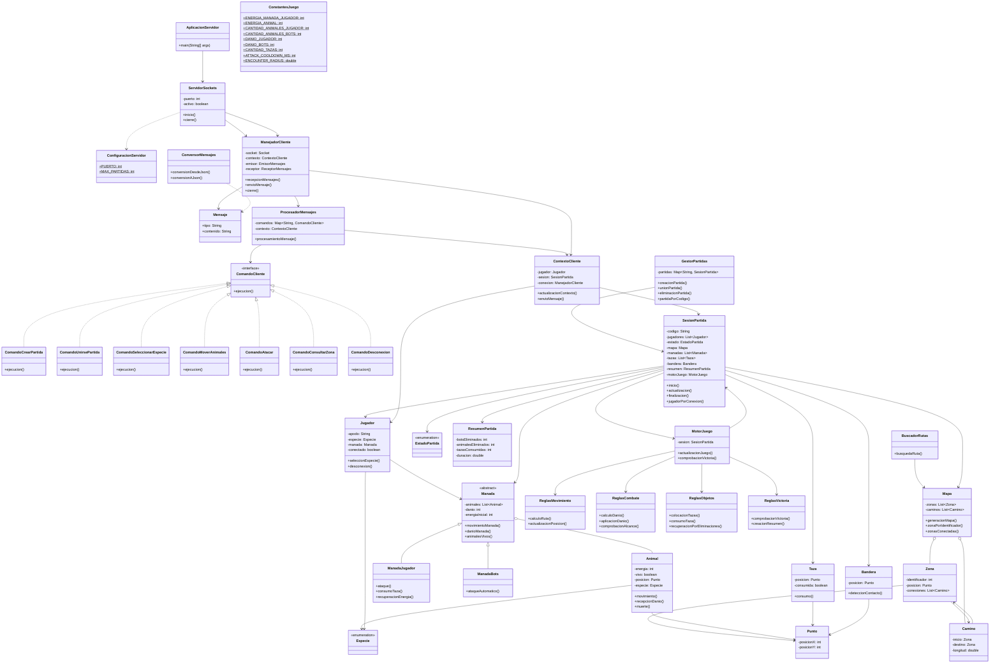

# JungleAttack

### jungleattack.servidor.aplicacion

**AplicacionServidor**
- Métodos: `main(String[] args)`

**ConfiguracionServidor**
- Atributos estáticos: `PUERTO: int`, `MAX_PARTIDAS: int`

### jungleattack.servidor.red

**ServidorSockets**
- Atributos: `puerto: int`, `activo: boolean`
- Métodos: `inicio()`, `cierre()`

**ManejadorCliente**
- Atributos: `socket: Socket`, `contexto: ContextoCliente`, `emisor: EmisorMensajes`, `receptor: ReceptorMensajes`
- Métodos: `recepcionMensajes()`, `envioMensaje()`, `cierre()`

### jungleattack.servidor.protocolo

**Mensaje**
- Atributos: `tipo: String`, `contenido: String`

**ConversorMensajes**
- Métodos: `conversionDesdeJson()`, `conversionAJson()`

**ProcesadorMensajes**
- Atributos: `comandos: Map<String, ComandoCliente>`, `contexto: ContextoCliente`
- Métodos: `procesamientoMensaje()`

### jungleattack.servidor.comandos

**ComandoCliente** — interfaz
- Métodos: `ejecucion()`

**ContextoCliente**
- Atributos: `jugador: Jugador`, `sesion: SesionPartida`, `conexion: ManejadorCliente`
- Métodos: `actualizacionContexto()`, `envioMensaje()`

**ComandoCrearPartida**
- Métodos: `ejecucion()`

**ComandoUnirsePartida**
- Métodos: `ejecucion()`

**ComandoSeleccionarEspecie**
- Métodos: `ejecucion()`

**ComandoMoverAnimales**
- Métodos: `ejecucion()`

**ComandoAtacar**
- Métodos: `ejecucion()`

**ComandoConsultarZona**
- Métodos: `ejecucion()`

**ComandoDesconexion**
- Métodos: `ejecucion()`

### jungleattack.servidor.partidas

**GestorPartidas**
- Atributos: `partidas: Map<String, SesionPartida>`
- Métodos: `creacionPartida()`, `unionPartida()`, `eliminacionPartida()`, `partidaPorCodigo()`

**SesionPartida**
- Atributos: `codigo: String`, `jugadores: List<Jugador>`, `estado: EstadoPartida`, `mapa: Mapa`, `manadas: List<Manada>`, `tazas: List<Taza>`, `bandera: Bandera`, `resumen: ResumenPartida`, `motorJuego: MotorJuego`
- Métodos: `inicio()`, `actualizacion()`, `finalizacion()`, `jugadorPorConexion()`

**Jugador**
- Atributos: `apodo: String`, `especie: Especie`, `manada: Manada`, `conectado: boolean`
- Métodos: `seleccionEspecie()`, `desconexion()`

**EstadoPartida** — enum

**ResumenPartida**
- Atributos: `botsEliminados: int`, `animalesEliminados: int`, `tazasConsumidas: int`, `duracion: double`

### jungleattack.servidor.modelo

**Animal**
- Atributos: `energia: int`, `vivo: boolean`, `posicion: Punto`, `especie: Especie`
- Métodos: `movimiento()`, `recepcionDanio()`, `muerte()`

**Manada** — clase abstracta
- Atributos: `animales: List<Animal>`, `danio: int`, `energiaInicial: int`
- Métodos: `movimientoManada()`, `danioManada()`, `animalesVivos()`

**ManadaJugador** — hereda de `Manada`
- Métodos: `ataque()`, `consumoTaza()`, `recuperacionEnergia()`

**ManadaBots** — hereda de `Manada`
- Métodos: `ataqueAutomatico()`

**Especie** — enum

**Taza**
- Atributos: `posicion: Punto`, `consumida: boolean`
- Métodos: `consumo()`

**Bandera**
- Atributos: `posicion: Punto`
- Métodos: `deteccionContacto()`

### jungleattack.servidor.mapa

**Punto**
- Atributos: `posicionX: int`, `posicionY: int`

**Zona**
- Atributos: `identificador: int`, `posicion: Punto`, `conexiones: List<Camino>`

**Camino**
- Atributos: `inicio: Zona`, `destino: Zona`, `longitud: double`

**Mapa**
- Atributos: `zonas: List<Zona>`, `caminos: List<Camino>`
- Métodos: `generacionMapa()`, `zonaPorIdentificador()`, `zonasConectadas()`

**BuscadorRutas**
- Métodos: `busquedaRuta()`

### jungleattack.servidor.reglas

**MotorJuego**
- Atributos: `sesion: SesionPartida`
- Métodos: `actualizacionJuego()`, `comprobacionVictoria()`

**ReglasMovimiento**
- Métodos: `calculoRuta()`, `actualizacionPosicion()`

**ReglasCombate**
- Métodos: `calculoDanio()`, `aplicacionDanio()`, `comprobacionAlcance()`

**ReglasObjetos**
- Métodos: `colocacionTazas()`, `consumoTaza()`, `recuperacionPorEliminaciones()`

**ReglasVictoria**
- Métodos: `comprobacionVictoria()`, `creacionResumen()`

### jungleattack.servidor.constantes

**ConstantesJuego**
- Atributos estáticos: `ENERGIA_MANADA_JUGADOR: int`, `ENERGIA_ANIMAL: int`, `CANTIDAD_ANIMALES_JUGADOR: int`, `CANTIDAD_ANIMALES_BOTS: int`, `DANIO_JUGADOR: int`, `DANIO_BOTS: int`, `CANTIDAD_TAZAS: int`, `ATTACK_COOLDOWN_MS: int`, `ENCOUNTER_RADIUS: double`

## Herencia, interfaces y polimorfismo

- `Manada` es la clase abstracta de `ManadaJugador` y `ManadaBots`.
- `ComandoCliente` es implementada por los comandos concretos.
- `ProcesadorMensajes` ejecuta los comandos mediante la interfaz `ComandoCliente`, utilizando polimorfismo.

## Elementos estáticos

- `ConfiguracionServidor` contiene las constantes de configuración del servidor.
- `ConstantesJuego` contiene las constantes de las reglas del juego.

## Patrones de diseño

**Command**

- Interfaz: `ComandoCliente`.
- Comandos concretos: `ComandoCrearPartida`, `ComandoUnirsePartida`, `ComandoSeleccionarEspecie`, `ComandoMoverAnimales`, `ComandoAtacar`, `ComandoConsultarZona` y `ComandoDesconexion`.
- Invocador: `ProcesadorMensajes`.
- Cada comando encapsula una operación solicitada por un cliente.

## Diagrama de clases

